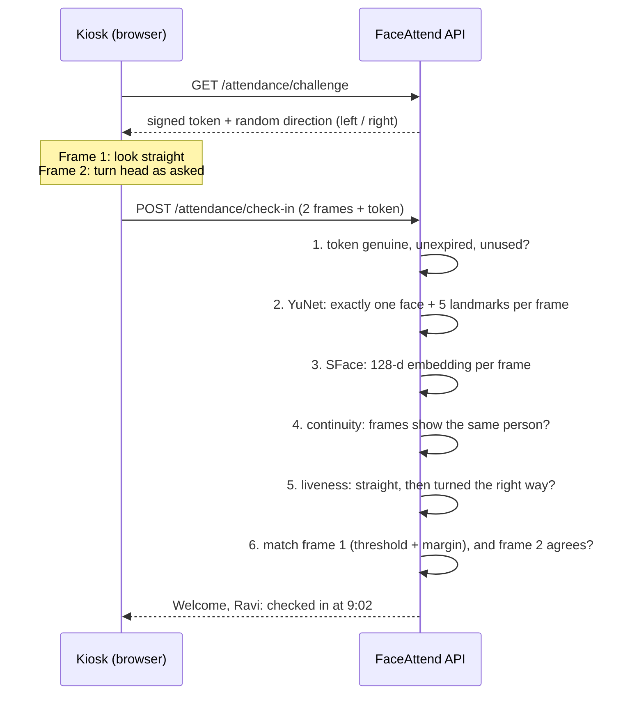

# FaceAttend

Face-recognition attendance for field technicians, with **server-verified liveness**. A shared tablet at a work site becomes a check-in kiosk: technicians look at the camera, turn their head when asked, and are checked in or out. Admins enrol technicians, review attendance and hours on site, and export reports.

**Stack:** Python · FastAPI · OpenCV (YuNet + SFace ONNX models) · NumPy · AES-256-GCM (cryptography) · SQLAlchemy + SQLite · React · TypeScript · Vite · TanStack Query · Tailwind CSS · Docker

> **Live demo:** _add your deployed URL here_

<!-- Add screenshots after you run the app -->
<!--  -->

---

## Contents

- [Features](#features)
- [How recognition works](#how-recognition-works)
- [Architecture](#architecture)
- [Project structure](#project-structure)
- [Getting started](#getting-started)
- [Configuration](#configuration)
- [API reference](#api-reference)
- [Engineering decisions](#engineering-decisions)
- [Privacy and responsible use](#privacy-and-responsible-use)
- [Testing](#testing)
- [Limitations and roadmap](#limitations-and-roadmap)

---

## Features

**Kiosk (check-in and check-out)**
- Live camera preview with an oval guide for positioning
- A guided two-step scan: look straight, then **turn your head the way the server randomly asks** (with an on-screen arrow)
- The visit is recorded as a **check-in or check-out automatically** (alternating per day)
- A result panel styled like a national-highway sign: "Welcome, Ravi · Checked in at 9:02 am"
- **Debounce:** a second scan within 2 minutes is confirmed, not turned into a check-out
- The site name is set once per device, for example "NH-44 Toll Plaza, Km 212"
- Clear guidance when a scan fails: no face, more than one face, too far away, didn't turn, turned the wrong way, not recognised, or ambiguous

**Admin**
- Technician management: employee code, name, trade, mobile, active or inactive
- **Face enrolment** with 1–3 photos per session (capture with prompts to look straight, then slightly left and right, or upload), up to 5 per person
- Protection against bad enrolments: duplicate photos are rejected, and a face that already matches **another** technician is refused
- Dashboard: present today, who's on site now, and unrecognised scans today
- Attendance log with date range, **hours on site** per technician, and **CSV export**

**Liveness and anti-spoofing**
- **Random head-turn challenge**, issued by the server as a signed, expiring, **single-use** token, so a printed photo can't turn and a recorded video can't know which way to turn
- **Verified on the server** from facial landmarks, so it can't be skipped by calling the API directly
- **Continuity check:** both frames must show the same person, which blocks swapping faces mid-scan
- **Multi-frame consensus:** both frames must identify the same enrolled technician

**Security and privacy**
- **Photos are never stored.** Only face embeddings are kept, **encrypted at rest with AES-256-GCM**, so a copied database reveals nothing biometric without the key
- Admin endpoints require an `X-Admin-Key` header, compared in constant time
- Rate limiting on the public check-in endpoint
- Image validation: type, size, EXIF rotation, and downscaling

---

## How recognition works



1. **Detection:** [YuNet](https://github.com/opencv/opencv_zoo/tree/main/models/face_detection_yunet), a small (~230 KB) ONNX model run by OpenCV, finds the face and 5 landmarks (eyes, nose tip, mouth corners). Exactly one face of at least 80 px is required.
2. **Embedding:** [SFace](https://github.com/opencv/opencv_zoo/tree/main/models/face_recognition_sface) aligns the face using the eye landmarks and converts it into 128 numbers. Photos of the same person point in a similar direction.
3. **Liveness:** head yaw is estimated as *(nose x − midpoint between the eyes) ÷ distance between the eyes*. The straight frame must be near 0, and the turned frame must clear `TURN_MIN_YAW` in the challenged direction.
4. **Matching:** cosine similarity against every enrolled (decrypted) template. A person's score is their best-matching photo. A match needs score ≥ `MATCH_THRESHOLD` **and** a lead of at least `MATCH_MARGIN` over the next most similar *person*, so lookalikes aren't confused.
5. **Consensus:** the turned frame must also point to the same technician.

No TensorFlow or GPU is needed: both models run on CPU inside OpenCV, and the Docker image stays small.

## Architecture

```
Tablet / browser ──► nginx ──► FastAPI ──► SQLite
  React kiosk +       /api      ├─ FaceEngine (OpenCV: YuNet + SFace ONNX)
  admin pages        proxy      ├─ liveness.py + challenge.py (pure, tested)
                                ├─ matching.py (pure, tested)
                                ├─ crypto.py (AES-256-GCM templates)
                                └─ images.py (validation, EXIF, resize)
```

The app depends on a small `FaceEngine` interface (`analyze(image) -> embedding + landmarks`). `OpenCVEngine` is the production implementation; the tests use a fake engine, so the suite runs in under a second with no models.

---

## Project structure

```
faceattend/
├── backend/
│   ├── app/
│   │   ├── main.py               App factory, CORS, rate limits, error handling
│   │   ├── config.py             Settings from environment variables
│   │   ├── db.py / models.py     SQLAlchemy: technicians, face templates, attendance, failed attempts
│   │   ├── schemas.py            Request and response models
│   │   ├── security.py           Admin key check (constant-time)
│   │   ├── crypto.py             AES-256-GCM encryption of face templates
│   │   ├── face/
│   │   │   ├── engine.py         FaceEngine interface + OpenCV YuNet/SFace implementation
│   │   │   ├── liveness.py       Yaw estimation and head-turn verification
│   │   │   ├── challenge.py      Signed, expiring, single-use challenge tokens
│   │   │   ├── gallery.py        Loads and decrypts enrolled templates
│   │   │   └── matching.py       Threshold + margin matching, duplicate detection
│   │   ├── services/images.py    Safe image decoding
│   │   └── routers/
│   │       ├── technicians.py    CRUD + face enrolment
│   │       └── attendance.py     Kiosk check-in, log, summary, CSV export
│   ├── scripts/download_models.py  Fetches the two ONNX models (~37 MB)
│   ├── tests/                    Liveness, challenge, encryption, matching and API tests
│   ├── requirements.txt          Production
│   └── requirements-dev.txt      Tests and linting (no models needed)
├── frontend/
│   └── src/
│       ├── pages/                Kiosk, Technicians, Enrol panel, Attendance, Admin gate
│       ├── components/           Layout, useCamera hook
│       └── lib/                  API client, admin key storage, time and hours helpers
├── .github/workflows/ci.yml
└── docker-compose.yml
```

---

## Getting started

### Generate two secrets first

```bash
python -c "import secrets; print('ADMIN_API_KEY=' + secrets.token_urlsafe(32))"
python -c "import os, base64; print('TEMPLATE_KEY=' + base64.b64encode(os.urandom(32)).decode())"
```

Keep `TEMPLATE_KEY` safe: it encrypts every enrolled face, and losing it means re-enrolling everyone.

### Option 1: Docker

```bash
git clone https://github.com/<your-username>/faceattend.git
cd faceattend
# put the two lines generated above into a file named .env in this folder
docker compose up --build
```

Open **http://localhost:8080**.

1. Go to **Technicians**, enter your admin key, and add a technician.
2. Enrol 2–3 face photos with the camera.
3. Go to **Kiosk**, set the site name, tap **Start scan**, and follow the prompts.

> Browsers only allow camera access on `localhost` or over HTTPS. To use a tablet on your network, serve the app over HTTPS (for example, deploy it, or use a tunnel such as Cloudflare Tunnel).

### Option 2: Run locally

**Backend** (Python 3.12):

```bash
cd backend
python -m venv .venv && source .venv/bin/activate   # Windows: .venv\Scripts\activate
pip install -r requirements.txt
python scripts/download_models.py                   # YuNet + SFace into ./models
cp .env.example .env                                # set ADMIN_API_KEY and TEMPLATE_KEY
uvicorn app.main:app --reload --port 8000           # API docs at http://localhost:8000/docs
```

**Frontend** (new terminal):

```bash
cd frontend
npm install
npm run dev                                         # http://localhost:5173
```

## Configuration

| Variable | Default | Description |
| --- | --- | --- |
| `ADMIN_API_KEY` | (none) | **Required** for admin pages and endpoints |
| `TEMPLATE_KEY` | (none) | **Required.** 32 random bytes (base64) used to encrypt face templates and sign challenges |
| `MODELS_DIR` | `./models` | Where the ONNX models are stored |
| `DATABASE_URL` | `sqlite:///./faceattend.db` | Any SQLAlchemy URL; PostgreSQL works too |
| `MATCH_THRESHOLD` | `0.42` | Minimum cosine similarity to accept a match. Raise it to reduce false matches. |
| `MATCH_MARGIN` | `0.06` | Required lead over the next most similar person |
| `CONTINUITY_THRESHOLD` | `0.30` | How alike the straight and turned frames must be |
| `STRAIGHT_MAX_YAW` / `TURN_MIN_YAW` | `0.12` / `0.20` | Head-turn liveness limits |
| `CHALLENGE_TTL_SECONDS` | `60` | How long a challenge stays valid |
| `DEBOUNCE_SECONDS` | `120` | Repeat scans within this window are ignored |
| `MAX_IMAGE_MB` | `5` | Upload size limit |
| `CORS_ORIGINS` | `http://localhost:5173` | Allowed frontend origins |

**Tuning the threshold:** enrol your team, then look at the "Match" column in Attendance. Genuine matches should score clearly above the threshold, and strangers clearly below it. Adjust based on your own data.

---

## API reference

Interactive docs at **`/docs`**. 🔑 = requires the `X-Admin-Key` header.

| Method | Route | Description |
| --- | --- | --- |
| `GET` | `/api/attendance/challenge` | Kiosk step 1: a signed token and a random head-turn direction |
| `POST` | `/api/attendance/check-in` | Kiosk step 2: `multipart` with `straight`, `turned`, `token` and `site`. Returns `checked-in`, `checked-out` or `already-recorded`. |
| `GET` | `/api/attendance` 🔑 | Records for `?start=YYYY-MM-DD&end=YYYY-MM-DD` (up to 3 months) |
| `GET` | `/api/attendance/summary` 🔑 | Present today, on site now, unrecognised scans |
| `GET` | `/api/attendance/export.csv` 🔑 | CSV report for a date range |
| `GET` | `/api/technicians` 🔑 | All technicians with enrolled photo counts |
| `POST` | `/api/technicians` 🔑 | Add a technician |
| `PATCH` | `/api/technicians/{id}` 🔑 | Update details or set active / inactive |
| `DELETE` | `/api/technicians/{id}` 🔑 | Delete a technician, their faces and their history |
| `POST` | `/api/technicians/{id}/faces` 🔑 | Enrol 1–3 photos (`files`) |
| `DELETE` | `/api/technicians/{id}/faces` 🔑 | Remove all enrolled faces |
| `GET` | `/api/health` | Health check |

---

## Engineering decisions

**Liveness the server can trust.** Client-side liveness checks can be bypassed by calling the API directly. Here the server picks the challenge, signs it, accepts it once, and checks the head turn itself from landmarks in the submitted frames.

**Randomness defeats replays.** Because the direction is random per attempt, a recorded video of someone turning left fails half the time, and a captured request can't be re-sent because each challenge nonce is single-use.

**Threshold plus margin, not just a threshold.** A threshold alone can still confuse two similar people when both score highly. Requiring the winner to beat the runner-up *person* by a margin makes ambiguous scans fail safely.

**Encrypted biometric templates.** Embeddings are encrypted with AES-256-GCM, which also detects tampering. The same key (via HMAC derivation) signs challenges, so there's one secret to manage.

**Small, CPU-only models.** YuNet and SFace run inside OpenCV with no TensorFlow or GPU, keeping the server image small and fast to start.

**Guarding enrolment quality.** The API rejects duplicate photos and refuses a face that already matches someone else, which catches enrolling the wrong person.

**Failures are data.** Unrecognised scans and failed liveness checks are logged with their reason, so admins can spot technicians who need re-enrolment, or attempted spoofing.

## Privacy and responsible use

Face data is sensitive personal data. This project is designed to minimise it:

- **No photos are stored:** images are processed in memory and discarded; only encrypted embeddings are kept.
- Deleting a technician deletes their embeddings and attendance history.
- Admins can reset a person's face data at any time.

Before using a system like this for real, get informed consent, explain what is stored and why, offer a non-biometric alternative (for example, a PIN), and follow applicable law, such as India's Digital Personal Data Protection Act, 2023.

---

## Testing

```bash
cd backend && pip install -r requirements-dev.txt && pytest -q   # no models needed
cd frontend && npm test
```

- **Liveness (7 tests):** yaw estimation, passing left and right turns, static photos, wrong direction, not starting straight, face swaps
- **Security (4 tests):** challenge signing, tampering, wrong secret, expiry; AES-GCM round trip and tamper detection; key validation
- **Matching (7 tests):** best template per person, threshold, ambiguity margin, no enrolments, duplicates, normalisation
- **API (17 tests):** the full enrol → challenge → check in → check out flow, debounce, static photo, wrong turn, face swap, replayed and forged challenges, unknown and inactive people, encryption at rest, enrolment guards, CSV export and cascade deletes
- **Frontend (3 tests):** hours-on-site pairing and formatting

The fake engine encodes identity in colour and head yaw in a small corner marker, so every liveness and recognition path runs deterministically without real models.

CI runs Ruff, pytest, ESLint, the frontend tests and a production build on every push.

---

## Limitations and roadmap

- **Liveness is challenge-based.** It stops photos and replayed videos, but a determined attacker with a realistic 3D mask or live deepfake could still try. Next steps: a passive anti-spoofing model (texture and reflection analysis) or a depth camera.
- **Accuracy depends on lighting and camera quality.** Test with your own devices and tune `MATCH_THRESHOLD`.
- Offline kiosk mode that queues scans when the network drops
- GPS or geofence check that the kiosk is at the declared site
- Per-supervisor accounts instead of a single admin key
- A vector index (e.g. pgvector) for organisations with thousands of people

---

## License

MIT. Built by **Nichenametla Keerthana** · [LinkedIn](https://www.linkedin.com/in/nichenametla-keerthana/)
